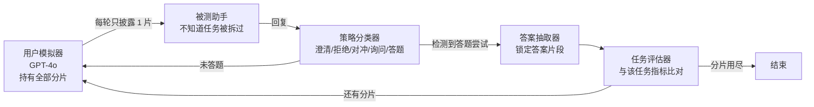
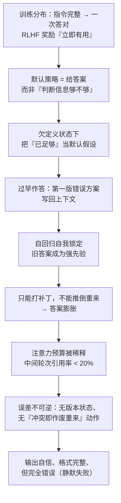

# LLMs Get Lost In Multi-Turn Conversation

> 精读笔记 · 2026-10-25 · 卢磊

## 论文信息

| 项目 | 内容 |
| --- | --- |
| 标题 | LLMs Get Lost In Multi-Turn Conversation |
| 作者 | Philippe Laban, Hiroaki Hayashi, Yingbo Zhou, Jennifer Neville |
| 机构 | Microsoft Research + Salesforce Research |
| 会议 | ICLR 2026（Outstanding Paper） |
| arXiv | [2505.06120](https://arxiv.org/abs/2505.06120)（2025-05-09 首次提交，cs.CL / cs.HC） |
| 方向 | LLM 评测 / 多轮对话 / 可靠性 |
| 关键词 | multi-turn evaluation, underspecification, sharded simulation, aptitude, unreliability |

---

## 一句话总结

**同一道题，只改变"一次说清"还是"分几轮说"，15 个顶尖模型平均掉 39 分——掉的不是能力，是稳定性。**

它把"对话一长模型就犯傻"这个模糊感受，变成了可复现、可分解的数字。

---

## 核心贡献

1. **提出并命名了"对话中迷失（Lost in Conversation）"现象**：在信息总量完全相同的前提下，多轮逐步披露需求会让所有被测模型性能平均下降 39%，连 GPT-4.1、Gemini 2.5 Pro 也无法避免，且模型规模不能免疫。
2. **把性能下降解耦为"能力"与"可靠性"两个正交维度**：用 10 次重复模拟的 P90 当能力上限、P90−P10 当不可靠度。结论是能力只降 16%，不可靠度暴涨 112%——**主要损失是稳定性，不是智力**。
3. **提出可扩展的"指令分片（sharding）+ 三角色模拟"评测框架**：把单轮完整指令拆成原子信息单元逐轮释放，用 LLM 模拟用户、自动策略分类 + 答案抽取 + 任务评分，从而在 20 万段对话规模上做受控实验，而不是靠人工体感。
4. **给出定性失效模式与机制归因**：模型在早期轮次就做出假设并**过早尝试最终答案**，随后过度依赖这个答案；一旦走错方向就无法自我恢复。同时指出外部 agent 框架（RECAP / SNOWBALL）只能挽回 15–20%，多轮可靠性必须内建。

---

## 研究背景与问题

真实用户遵循"最省力原则"：先给一个模糊需求，再通过多轮对话逐步澄清。但 LLM 的评测长期停留在"单轮、完全指定"的真空环境里。已有的多轮基准（如 MT-Bench）又是**碎片式（episodic）**的——每一轮都是自包含子任务、可以独立评分，根本没有覆盖"必须跨轮融合信息才能补全欠定义指令"这一真实场景。

于是出现一个系统性偏差：**榜上 90 分，落地一塌糊涂。** 论文要回答的是：在信息量不变的前提下，仅仅把"怎么说"从一次说清改成多轮披露，性能会掉多少？掉在哪？

---

## 方法：把"多轮"变成可测的实验

### 1. 指令分片（Instruction Sharding）

把一条单轮完整指令拆成更小的信息单元，逐轮只放一片。

| 步骤 | 做法 | 目的 |
| --- | --- | --- |
| ① 分割 | 用 LLM 把复杂指令拆成原子内容单元（ACU），每个单元对应一条具体要求或约束 | 保证分片是可独立陈述的信息 |
| ② 重构 | 把每个片段重写成自然的对话语句，消除片段间的上下文依赖 | 让它像人说话，而不是像被切碎的 prompt |
| ③ 验证 | 对比"原始指令"与"分片后全部拼回"的得分，确认没有关键信息丢失、且顺序无关 | **信息等效性**——排除"任务变难"这个混淆变量 |
| ④ 人工质检 | 研究员逐一审核逻辑与自然度，剔除过于机械或对抗性的分片 | 逼近真实场景，避免模型被"恶意"分片打败 |

第 ③ 步是整个实验成立的基石：**只改变信息披露的节奏，不改变信息量**，才能把"多轮"这一变量的效应单独锁出来。

### 2. 三角色模拟闭环



关键设计是**被测助手不被告知任务被拆解过**——它看到的就是一个普通用户在慢慢补充需求，这才是真实部署的样子。另一个关键细节是**只有"答题尝试"才计分**：澄清、拒绝、对冲都不算错，这样才不会把"谨慎追问"误判成失败。

### 3. 度量：能力与可靠性解耦

每个（指令 × 模型 × 模拟类型）组合独立跑 **10 次**，利用 LLM 采样的随机性构造分布：

| 指标 | 定义 | 直觉含义 |
| --- | --- | --- |
| 平均分 P̄ | 10 次模拟得分的均值 | 平时考多少分 |
| 能力上限 A | 第 90 百分位得分（P90） | **会不会做**（理想状态下限） |
| 不可靠度 U | P90 − P10 | **稳不稳**，同一道题最好与最差的差距 |

这是全文最重要的度量创新。只看平均分，会把"能力够但极不稳定"的模型判成"能力不足"，并因此开错药方（去堆模型规模而不是去改交互流程）。

### 4. 五种模拟类型的对照设计

| 类型 | 做法 | 作用 |
| --- | --- | --- |
| FULL | 单轮给出完整原始指令 | 基准组，模型能力上限 |
| CONCAT | 把所有分片拼成一条长指令，单轮发 | **关键对照组**：区分"信息重述"与"分批给" |
| SHARDED | 多轮，每轮披露一片 | 核心实验组 |
| RECAP | SHARDED + 最后补充一轮汇总所有分片 | 测"外挂式补救"效果 |
| SNOWBALL | 每轮重复此前已披露的所有分片 | 同上，更强的重述 |

---

## 实验设置

- **任务（6 类生成式）**：代码生成（HumanEval / LiveCodeBench）、Text-to-SQL（Spider）、函数调用（BFCL）、基础数学（GSM8K）、表格转文本（ToTTo）、多文档摘要（Summary of a Haystack）。共约 **600 条指令**。
- **模型（15 个）**：GPT-4o、GPT-4o-mini、GPT-4.1、o3、Claude 3.7 Sonnet、Claude 3 Haiku、Gemini 2.5 Pro、Gemini 2.5 Flash、Llama-3.1-8B、Llama-3.3-70B、Llama-4-Scout、DeepSeek-R1、Phi-4、OLMo-2-13B、Command-A。覆盖开源/闭源、8B 到 300B+。
- **规模**：**20 万+ 段模拟对话**，每组合重复 10 次。
- **误差控制**：人工核验评分误差 < 5%；对模型不利（低估）的偏差 < 2%。

---

## 实验结果

### 主结果：全线溃败

单轮 FULL 平均约 90 分，多轮 SHARDED 平均约 65 分，**平均下降 39%**。

典型单例（整体平均分）：

| 模型 | 单轮 | 多轮 | 跌幅 |
| --- | --- | --- | --- |
| GPT-4.1 | 91.7 | 70.7 | −21.0 |
| Claude 3.7 Sonnet | 85.4 | 70.0 | −15.4 |
| Gemini 2.5 Pro | 90.2 | 64.3 | −25.9 |

**规模不是解药**：大模型与小模型的跌幅没有显著差别。

### 分解：能力只掉一点，可靠性塌了

| 指标 | 变化 | 解读 |
| --- | --- | --- |
| 能力上限 P90 | **−16%** | 还会做，目标没忘 |
| 不可靠度 P90−P10 | **+112%** | 同一道题最好与最差相差约 **50 分** |

这才是论文最锋利的一刀：**多轮对话不把模型变笨，而是把它变得不可预测。** 对生产系统来说，一个 85 分但方差极大的模型，比一个 75 分但稳定的模型更难用——因为你没法安排兜底策略。

### 三个反直觉的对照

1. **CONCAT ≈ 95.1% 的单轮表现**：把分片拼回一条长指令后几乎完全恢复。所以问题**不是信息被重述、也不是指令变长，而是"分批给"这个交互形式本身**。这是最干净的排除法。
2. **2 个分片就足以触发崩塌**：从 1 轮变 2 轮，不可靠度就发生质变；继续增加轮次（最多 8 片）并不会更差。说明崩的不是上下文长度，而是**第一次承诺**。
3. **降温度几乎无效**：T≈0 能改善单轮稳定性，但多轮下 U 仍约 30%。说明这不是采样随机性问题，是**结构性偏差**。

### 外挂式补救的天花板

RECAP（末尾汇总全部需求）与 SNOWBALL（每轮重述已披露需求）只能挽回 **15–20%** 的损失，远达不到单轮水平。额外增加推理 token（test-time compute）同样无效。

> 结论：不要指望在模型外面套一层 LangChain / AutoGen 把问题"解释"掉，多轮可靠性必须做成模型的**原生能力**。

---

## 四类失效模式

| 病灶 | 表现 | 论文中观察到的量化特征 |
| --- | --- | --- |
| ① 过早作答 | 缺信息时先假设，直接交完整方案 | 在对话前 20% 就给出完整答案；早答正确率 **30.9%**，等到更多信息再答 **64.4%** |
| ② 答案膨胀 | 在错误答案上叠加修改，越改越偏 | 代码输出从约 **700 字符涨到 1400**（+20%~300%）；6 个任务里 5 个是"短回答比长回答高 10–50%" |
| ③ 丢失中段 | 只盯首轮与末轮，中间分片被跳过 | 对**中间轮次的引用率 < 20%** |
| ④ 过度冗长 | 推理模型回复更长，更易自我带偏 | 推理型模型回复平均**长 33%**，冗长内容中大量是无效假设 |

---

## 机制分析：为什么会退化成这样

论文自己的表述是"都在过早收敛，之后再不自查"。但这只是对现象的同义反复，不是原因。结合 20 万段日志里的行为统计，可以拆成一条**有因果顺序、且不可逆**的链：



逐层说明：

**第一层 · 训练分布错配（最根本）**
预训练语料与 RLHF 偏好数据几乎都是"指令完整 → 一次答对"，且人类评分偏好"立即有用"的回答。模型因此学到 `p(回答 | 任意上下文) ≈ 1`，而不是 `p(先确认再回答)`。**"先答"在单轮里是优点，在多轮里直接变成锚。** 这解释了为什么强模型也躲不过——这不是知识或推理的缺陷，是目标函数塑造出的行为倾向。

**第二层 · 缺少"信息充分性"判据**
多轮欠定义本质是一个部分可观测决策问题（POMDP）：正确动作是先估计"还缺多少信息"，再决定问还是答。模型没有这个显式判据，只能用先验顶上，而先验强烈偏向"已经够了"。这解释了"2 个分片就触发"——崩的不是长度，是**第一次强承诺**。

**第三层 · 自回归的自我锁定**
答案一旦生成，就作为上下文参与后续每一轮的分布计算。模型对自己的输出有很强的"前后一致"倾向（可以理解为自我谄媚 self-sycophancy）：后续分片不是被用来**修正**方案，而是被用来**解释**既有方案。这就是"走错一步回不来"的机制根源。答案膨胀因此不是"模型不会改"，而是"模型只会叠加式地改"——补丁是追加的，不是替换的。

**第四层 · 没有回退机制**
工程里改需求可以回滚版本、重跑构建；对话里模型既没有版本化状态，也没有"检测到与已有假设冲突就作废重来"的动作。缺这一层，误差链是**不可逆**的，最终表现为**静默失败**：一个格式漂亮、语气自信、内容全错的答案，能通过表层审阅。

> 一句话：**这四类病灶不是四个独立 bug，而是同一个 bug 的四个阶段。**

---

## 什么样的任务最危险

论文明确指出不是所有任务都会退化（翻译这类可分解任务完全不退化）。风险取决于三个特性：

1. **生成式而非抽取/分类**：需要持续编辑、优化产出的内容（代码、摘要、SQL）。
2. **有多个需要融合的明确要求**：能拆成多个分片，才有暴露空间。
3. **解不可分解**：新增一片会改变整体方案（数学计算、API 组合调用）。反过来，逐句翻译这类"每片只影响自己那一片"的任务不受影响。

**判据：如果你能对任务说"再补一条需求，前面写的可能要全部重来"，它就是高危任务。**

---

## 对实践的启示

### 评测侧

- 单轮平均分 ≈ 只看能力上限，会系统性高估。**应同时报 P̄ / P90 / P90−P10**，部署前真正该看的是 U。
- 多轮评测要保证**信息等效性**（分片拼回 ≈ 原始指令），否则测的是"任务变难"而不是"多轮"。
- 需要"策略分类 + 只在答题时计分"的评分逻辑，把"谨慎追问"与"答错"区分开。

### 工程 / Agent 侧

- **"需求预汇总"比"多轮追问"更划算**：Concat 对照证明信息等价时单轮远好于多轮。主动把散落需求合并成一条完整指令再提交，收益远大于让模型在对话里自己拼。
- **强制"重写而非追加"**：拿到新信息后先输出一版全新答案，禁止在旧答案上打补丁——直接针对答案膨胀。
- **维护结构化需求清单**（需求 → 已确认 / 待确认），不依赖自由文本记忆——直接针对丢失中段。
- **加检查点**：在关键决策前显式要求"复述当前已知条件 + 列出缺口"，把隐式的信息充分性判断变成显式动作。
- 别指望外挂：RECAP/SNOWBALL 只有 15–20% 的效果，中间层解决不了根问题。

### 用户侧

- 时间允许时，**一次性把需求说全**，或先把散落要求汇总再重开一轮。
- 发现模型"跑偏"时，**重开会话**往往优于在原对话里继续纠正——因为锚已经形成了。

---

## 局限

1. **用户行为由 LLM 模拟**：无法复现真实人类的情绪、误解、术语偏差与中途改需求，模拟器本身可能有系统性偏好。
2. **任务范围偏分析型**：6 类任务都有标准答案，未覆盖创意写作等开放式任务，结论外推需谨慎。
3. **仅英文文本、单模态**：多语言与多模态下的"迷失"是否同构，未验证。
4. **分片披露模式较固定**：真实对话中信息披露是随机、非线性的，甚至自相矛盾。
5. **成本**：每组合重复 10 次，20 万段对话的评测开销不小，小团队直接复用有门槛。

---

## 我的思考

**最值得学的不是"39%"这个数字，而是它的实验设计。**

- **"信息等效性验证"这一步是整个实验的命门**。绝大多数"多轮 vs 单轮"的对比都死在这里：多轮版本天然更长、更啰嗦、更容易漏，你测到的到底是"多轮"还是"任务变难"？论文用第 ③ 步 + CONCAT 对照把这条路彻底堵死——**先证明信息没丢，再谈形式的影响**。这个思路可以直接搬到我自己的实验设计里。
- **"P90 − P10 当不可靠度"是个极便宜的好指标**。它不需要任何额外标注，只要有重复采样就能算。凡是"同一输入跑多次"的评测，都应该顺手加上这个数。
- **"只在答题尝试时计分"这一条容易被忽略但很关键**。否则模型学会"多问少答"就能刷分，而"多问"恰恰是论文希望鼓励的行为。指标设计会反向塑造模型行为，这一点值得警惕。
- **因果链比结论更有用**。论文的定性部分停在"过早收敛"，但真正的工程抓手在于：既然根因是"第一版错误答案进入上下文"，那所有对策都应该围绕**阻止第一版过早固化**（拆检查点）和**允许第一版被作废**（版本化重写）来做，而不是去调温度、堆 token、加 agent 框架——这三个恰恰是论文证明无效的。

**可延伸的方向**

- 把 U 指标接到自己的 agent 评测里，看"单轮高分"的模型在 U 上是否真的分不出优劣。
- 反过来利用这条结论：**能否训练/提示模型显式输出"当前已知 / 待确认"两张清单**，把隐式判据外化？这是论文呼吁的"原生多轮可靠性"最轻量的一个落点。
- 分片评测能否迁移到工具调用密集的 agent 场景（多轮 tool result 逐步返回，本质就是 sharding）。

---

## 引用

```bibtex
@inproceedings{laban2025lost,
  title     = {LLMs Get Lost In Multi-Turn Conversation},
  author    = {Laban, Philippe and Hayashi, Hiroaki and Zhou, Yingbo and Neville, Jennifer},
  booktitle = {International Conference on Learning Representations (ICLR)},
  year      = {2026},
  note      = {arXiv:2505.06120},
  url       = {https://arxiv.org/abs/2505.06120}
}
```

> 说明：主结果（39% / 16% / 112% / 95.1%）与四类失效模式的量化特征（30.9% vs 64.4%、700→1400 字符、中间轮引用率 < 20%、回复长 33%）取自论文正文与其定性分析节；机制分析部分（四层因果链）为本人基于论文结论的归纳与延伸，非原文表述。
